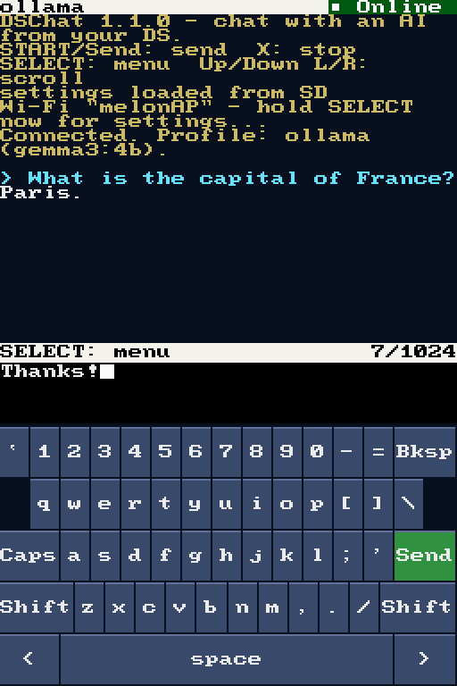
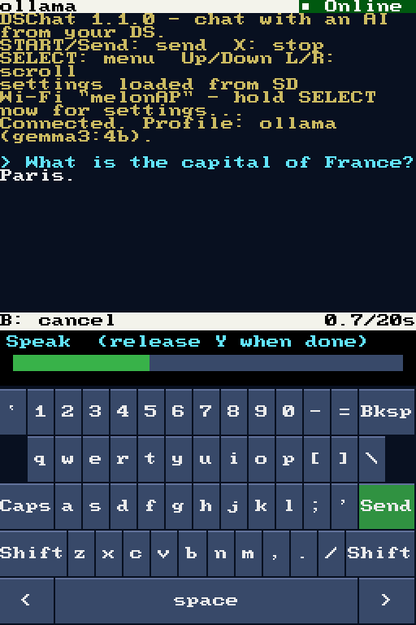
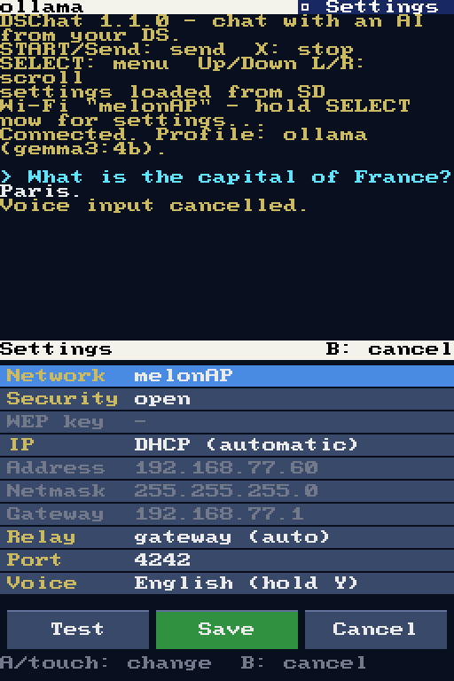

# DSChat

<p align="center">
  
</p>
<p align="center"><sub>melonDS emulator screenshot</sub></p>

Chat with an AI (Claude, Gemini, Qwen, OpenAI, a local Ollama model, ...) from
a **Nintendo DS Lite**. The DS is the screen and keyboard, and its microphone:
hold Y to dictate. A small relay on a Linux laptop holds the API keys, talks
to the AI provider and turns speech into text locally.

The DS Lite's Wi-Fi is from 2004: 2.4 GHz 802.11b, open or WEP networks only,
no modern TLS. So the laptop makes a small access point just for the DS, and
the DS talks a tiny plain-TCP protocol to the relay on that laptop. Only the
relay ever touches the internet.

**What it looks like:** the top screen shows the conversation, the bottom
screen a touch keyboard. You type (or hold Y and speak), press START, and the
AI's answer streams onto the top screen a few seconds later, word-wrapped to
the DS's 32 columns. A status bar shows the AI profile and the connection
state. The menu has new chat, profile switch, settings, diagnostics and power
off.

Version 1.1.0. MIT licence.

```
 phone hotspot (WPA2, 2.4 GHz) ──── internet
        │
        │ the laptop's Wi-Fi interface (managed, as usual)
  ┌─────┴──────────── laptop (Linux) ───────────────────────────────┐
  │  same radio, same channel:                                      │
  │  dsap0 = access point "DSCHAT" (open or WEP), 192.168.77.1/24   │
  │          DHCP for the DS, firewall: only DHCP + relay port      │
  │  relay  192.168.77.1:4242  ── HTTPS ──>  AI provider APIs       │
  │         (API keys in relay/.env, never on the DS)  or Ollama    │
  └─────┬───────────────────────────────────────────────────────────┘
        │ 802.11b, plain TCP (docs/PROTOCOL.md)
     DS Lite + flashcard running dschat.nds
```

The DS gets no internet access at all: no routing or NAT for its network.
The conversation history lives in the relay's memory, not on the DS.

## Requirements

* **Nintendo DS Lite** (or DS) and a **flashcard** whose DLDI driver works
  with BlocksDS ROMs (needed to save settings; without it the app still runs
  with defaults).
* **A Linux laptop** whose Wi-Fi card can be a client and an access point **at
  the same time, on the same channel** (see below), with NetworkManager.
  Packages: `hostapd` (built with WEP if you want WEP), `dnsmasq`, `iw`,
  `nftables`, `iptables`, Python 3.12+. On Debian/Ubuntu:
  `sudo apt install hostapd`; the rest is usually installed.
* **Internet over a 2.4 GHz Wi-Fi network**, for example an Android phone
  hotspot set to 2.4 GHz. The laptop's AP must share that channel, and the DS
  only does 2.4 GHz. (USB tethering also works; see "Without Wi-Fi upstream".)
* **Docker**, to build the ROM (the BlocksDS toolchain image is pulled
  automatically). Not needed if you only copy a ready-made `.nds`.
* An **API key** for at least one provider, or Ollama running locally.

### Does my Wi-Fi card support it?

Run `iw list` and look for "valid interface combinations". You need a line
that allows a managed (client) interface and an AP at the same time, for
example:

```
valid interface combinations:
     * #{ managed } <= 1, #{ AP, P2P-client, P2P-GO } <= 1, #{ P2P-device } <= 1,
       total <= 3, #channels <= 1
```

`#channels <= 1` is normal: the AP then runs on whatever channel your
hotspot uses, which is why the hotspot must be on 2.4 GHz. If AP and managed
never appear together, the card can't do it; use USB tethering for internet
and give the Wi-Fi card to the AP alone (see Troubleshooting).

### Tested hardware

DSChat 1.1 was tested with an Intel Wireless-AC 9560, a DS Lite, and an
R4-style flashcard (Wood R4 kernel). Other combinations should work if they
meet the requirements above.

## Setup (once)

```sh
git clone <this repo> DSChat && cd DSChat

# 1. relay
python3 -m venv relay/.venv
relay/.venv/bin/pip install -r relay/requirements.txt
cp relay/.env.example relay/.env && chmod 600 relay/.env
#    edit relay/.env: put your key(s), set ACTIVE_PROFILE (e.g. gemini)

# 2. laptop settings for ./dschat (Wi-Fi security of the DS network)
cp net/dschat.conf.example net/dschat.conf && chmod 600 net/dschat.conf
#    edit net/dschat.conf: SECURITY=wep and WEP_KEY=<13 characters>, or SECURITY=open

# 3. the ROM
(cd ds && make)            # -> ds/dschat/dschat.nds

# 4. optional: voice input (hold Y). Local speech-to-text (faster-whisper),
#    downloads ~768 MB (shows the sizes and asks first; --yes on another network)
relay/voice/setup.sh
```

Optional: let only your DS join. Copy `net/allowed_macs.example.txt` to
`net/allowed_macs.txt` (gitignored) and put your DS's MAC address in it. The
DS shows its MAC under menu > About, and `./dschat logs` prints the MAC of
every device that joins.

The Wi-Fi interface is detected automatically: the connected managed Wi-Fi
interface, and the default route's interface as the internet side. If you
have several, or want a specific one, set `WIFI_IFACE` / `UPSTREAM_IFACE` in
`net/ap.conf`. The AP's MAC address is derived from your card's at run time.

## API keys and profiles

A **profile** = an AI provider + model + options, defined in
`relay/providers.toml` (committed, no secrets). Each profile names the
*environment variable* holding its key; the keys themselves go only in
`relay/.env` (gitignored, keep it `chmod 600`). `ACTIVE_PROFILE` in `.env` is
the default; the DS can switch profiles from its menu.

| Profile | Provider / adapter | Model | Key variable |
|---|---|---|---|
| `claude` | Anthropic (native SDK) | `claude-haiku-5-5` | `ANTHROPIC_API_KEY` |
| `gemini` | Google, OpenAI-compatible | `gemini-3.5-flash-lite` | `GEMINI_API_KEY` |
| `qwen` | Alibaba Model Studio (Singapore) | `qwen3.8-flash` | `DASHSCOPE_API_KEY` |
| `openai` | OpenAI | `gpt-6-luna` | `OPENAI_API_KEY` |
| `ollama` | local Ollama, OpenAI-compatible | `gemma3:4b` | none |

Templates for Mistral, DeepSeek, Groq and OpenRouter are in the file; any
OpenAI-compatible API works. Every profile gets the same short system prompt
(plain ASCII, short answers for a 32-column screen). Reasoning text never
reaches the DS. Switching profile starts a new conversation.

```sh
relay/.venv/bin/python relay/relay.py --check-config   # which profiles have a key
python3 tools/client.py --host 192.168.77.1 --check gemini   # one real round trip via ./dschat's relay
```

## Starting and stopping

```sh
./dschat start     # asks for your sudo password
./dschat status    # AP, hotspot channel, relay, connected DS, last error
./dschat logs      # follow relay + AP events (Ctrl-C stops watching only)
./dschat restart-relay
./dschat stop      # removes everything, restores the system
```

`start` checks that the hotspot is on 2.4 GHz, brings up the AP in the mode
from `net/dschat.conf`, starts the relay as your user, and prints a summary
(SSID, security, voice on/off, profiles with keys). Everything runs in **transient systemd
units** (`dschat-ap.scope`, `dschat-relay.service`, `dschat-watch.service`).
Closing the terminal or logging out does not stop them, but nothing is
enabled at boot and a reboot leaves no trace. `stop` saves the logs to
`net/logs/last/`.

**Hotspot changes channel** (for example the phone hotspot restarted): the
watcher notices within 5 s and restarts the AP on the new channel; the DS
reconnects by itself. If the hotspot moves to 5 GHz, or is gone for 45 s, the
AP steps aside so the laptop can follow the hotspot, and it comes back once
the hotspot is on 2.4 GHz again. `./dschat status` shows what happened.

The lower-level scripts still work on their own, for debugging: `sudo
net/ap-up.sh [--wep KEY | --wep-file FILE]`, then `relay/.venv/bin/python
relay/relay.py` in a terminal, then `sudo net/ap-down.sh`. Don't mix them with
a running `./dschat`.

### Open or WEP

`net/dschat.conf`: `SECURITY=open` (no password) or `SECURITY=wep` with
`WEP_KEY=` 13 characters (or 5 characters, or 10/26 hex digits). The DS Lite
cannot do WPA, so WEP is the strongest option; it can be cracked, but it keeps
casual users off. On the DS: Settings > Network: pick `DSCHAT` (shown as WEP),
type the same key, Test, Save.

## Copying the ROM

Copy `ds/dschat/dschat.nds` anywhere on the flashcard's microSD. The flashcard
menu shows it as **DSChat**, "Chat with an AI from your DS", version 1.1.0,
with a speech-bubble icon. On first start the app creates `dschat/settings.txt`
on the SD card when you save the settings.

## Using the app

**Top screen:** status bar (black on white): the profile on the left, the
connection state on the right in a dark box with a marker: ■ online,
□ connecting or busy, `!` offline or failed. `v more` appears when you have
scrolled up and newer text is below. Under it is the conversation: your
messages in cyan after `> `, AI text in white, notices in yellow, errors in
red.

**Bottom screen:** the input box (4 lines, `n/max` counter) and a touch
keyboard (Shift, Caps, all ASCII symbols; keys light up when pressed). Tap in
the input box to move the cursor.

| Control | Action |
|---|---|
| Send key / START | send |
| Stop key / X | cancel the reply (the Send key turns into Stop while waiting) |
| B | backspace |
| D-pad left / right | move the cursor |
| D-pad up / down | scroll one line |
| L / R | scroll a page |
| SELECT | menu |
| hold Y | voice input: speak, release to get the text (B cancels) |

**Menu:** New chat, Switch profile, Settings, Reconnect, Soak test (Wi-Fi
diagnostic), About (version, MAC, IP, relay, settings file, counters), Power
off (asks first; No is preselected).

### Voice input (hold Y)

<p align="center">
  
</p>
<p align="center"><sub>melonDS emulator screenshot</sub></p>

1. Hold **Y** in the chat screen. The input box turns into a level bar:
   "Wait..." for 0.3 s while the microphone powers up, then **"Speak"**.
2. Speak (up to 20 s; the bar shows your level, red means too loud). Your
   speech is compressed (IMA ADPCM, 8 KB/s) and streamed to the laptop while
   you talk.
3. Release Y. A couple of seconds later the text appears in the input box
   at the cursor. It is **not sent**: fix it with the keyboard if needed,
   then press START.

B cancels at any point. Nothing heard: "Didn't catch that." and the input
is left as it was. The language (English or Italian) is a setting. The relay
must have voice installed (`relay/voice/setup.sh`); otherwise Y says "Voice
input not available on this relay". About shows the last voice timings.

While the AI thinks, the conversation shows `Waiting... Ns`. If a reply fails,
the error appears in red and your message goes back into the input box. Lost
connections (relay restart, Wi-Fi drop, closed lid) are retried by themselves.

### Settings screen and `settings.txt`

<p align="center">
  
</p>
<p align="center"><sub>melonDS emulator screenshot</sub></p>

At start-up, with a valid settings file, the app waits 3 s ("hold SELECT for
settings") and connects. With no file or a broken one, the settings open by
themselves, pre-filled, with the problem shown. If the first connection fails
3 times, they open with the reason.

* **Network**: scan list (SSID, channel, signal, open/WEP/WPA; WPA networks
  are shown but cannot be used), or *Hidden...* to type an SSID.
* **Security** open/WEP and **WEP key**. Test and Save stay disabled, with
  the reason shown, while the key is missing or invalid.
* **IP**: DHCP, or static address / netmask / gateway on a big number pad.
* **Relay**: the network's gateway (auto) or an IPv4 address, and the port.
* **Voice**: the language you speak when holding Y, English or Italian.
* **Test** checks each step and reports it in the conversation: find the
  network, join, get an IP (and DNS), reach the relay. **Save** writes the
  file and connects; **Cancel** keeps the old settings.

`dschat/settings.txt` is plain text, editable on a PC. `#` starts a comment
line. A bad line is reported on the DS and replaced by the default. It is
written safely (temp file, then rename) and never holds API keys; it does
hold the WEP key, if you use one.

```
ssid = DSCHAT
# open or wep
security = wep
wep_key = 13characters!
# dhcp or static (static_* lines are used only with ip = static)
ip = dhcp
static_ip = 192.168.77.60
static_mask = 255.255.255.0
static_gw = 192.168.77.1
# auto = the network's gateway, or an IPv4 address
relay_host = auto
relay_port = 4242
# last used AI profile, chosen again on connect
profile = gemini
# voice input language (hold Y): en or it
voice_lang = en
```

Without an SD card (or a flashcard without DLDI) the app uses its defaults
(network `DSCHAT`, open, DHCP, relay on the gateway port 4242), and changes
last until power off.

## Troubleshooting

* **`./dschat start`: hotspot is on 5 GHz**: set the phone hotspot to 2.4 GHz
  (on Android: Hotspot > Band), wait for the laptop to reconnect, retry.
* **The DS joins but stays at "IP address" / DHCP**: DSWiFi only finishes DHCP
  if the server also sends a DNS server, and our dnsmasq does. With another
  AP, use a static IP in the DS settings, or make that AP send DNS.
* **The DS never joins**: is its MAC in `net/allowed_macs.txt` (or the file
  empty)? `./dschat logs` shows refused stations. Same security on both
  sides? Test says "network uses WEP" or "network is open" when they differ.
  Wrong WEP key: DHCP times out ("wrong WEP key?").
* **"relay: connect timed out / refused"**: `./dschat status`. The relay
  address in the DS settings must be `auto` or 192.168.77.1, port 4242.
* **Slow answers**: the AI provider is slow, not the DS. Gemini can take
  10-20 s to the first word. The DS waits up to 130 s and shows
  `Waiting... Ns`; X cancels.
* **"profile ... has no API key"**: add the key to `relay/.env`, then
  `./dschat restart-relay`.
* **"too many messages, wait a minute"**: the relay allows 10 messages per
  minute per DS (`MAX_SEND_PER_MIN` in `relay/.env`), to protect your API
  quota.
* **melonDS**: its emulated Wi-Fi stops about 70 s after the ROM starts.
  That's an emulator bug (the real DS Lite passed a 3-minute soak test);
  restart the ROM.
* **"Voice input not available on this relay"**: install it with
  `relay/voice/setup.sh`, then `./dschat restart-relay`. `./dschat status`
  shows `voice: on (small, en/it)` or `voice: off (<reason>)`.
* **Voice text is wrong**:
  * check the Voice language setting;
  * speak 15-20 cm from the DS, not right into the microphone (the bar
    should rarely turn red);
  * put names and words you use often in `VOICE_HINTS` in `relay/.env`;
  * on a slow laptop, set `VOICE_MODEL=base` (faster, less accurate).
* **Without Wi-Fi upstream**: with USB tethering, set `UPSTREAM_IFACE` in
  `net/ap.conf` to the USB interface. The laptop's Wi-Fi then only runs the
  AP, on `AP_CHANNEL`.

## Security notes

* **API keys stay on the laptop**: only in `relay/.env` (gitignored, mode
  0600; the relay warns otherwise). They are never sent to the DS, never put
  in the ROM or `settings.txt`, and never logged. The log formatter also
  redacts anything that looks like a key, as a safety net.
* **The DS network is open or WEP**, the best the DS Lite can do, so anyone
  nearby may join it (open) or crack it (WEP). Limits on what they can do:
  * an optional MAC allowlist (spoofable, but it stops casual joins);
  * client isolation (stations can't talk to each other);
  * no routing to the internet or your other networks;
  * a firewall that lets in only DHCP and the relay port, with the AP address
    reachable only from the AP itself.
* **The relay** listens only on the AP address (192.168.77.1). Frames are
  limited to 4 KB, messages to 1 KB, 10 messages per minute per client. It
  has timeouts on every step and a 4-connection cap, and connections that
  don't speak the protocol within 20 s are dropped. It runs as your user,
  never root, in a systemd sandbox (read-only system and home, no new
  privileges).
* **Logs** hold connection events, sizes, timings and errors, never message
  text, unless you set `RELAY_DEBUG=yes` in `net/dschat.conf` (or run the
  relay with `--debug`). The DHCP log holds MACs and IPs. Logs live in `/run`
  (gone at reboot) and are copied to `net/logs/last/` (gitignored) on stop.
* **Voice audio** goes only to your laptop and is transcribed there: no
  cloud service, never written to disk. Transcripts are logged only with
  `RELAY_DEBUG=yes`. The microphone amplifier is on only while Y is held.
* **The WEP key** lives in `net/dschat.conf` (0600, ./dschat refuses
  otherwise) and in the AP's runtime config (`/run/dschat`, 0600). It is
  never shown in summaries or kept in saved logs.
* The TCP link between DS and relay is not encrypted (the DS can't do modern
  TLS). WEP is the only protection on that hop.

## Known limitations

* No WPA on the DS Lite: open or WEP only. 2.4 GHz only.
* The laptop's AP shares the hotspot's channel. If the hotspot changes
  channel, the AP follows it and the DS reconnects after a short break.
* Conversations live in the relay's memory: a relay restart starts a new
  conversation (the DS says so). One conversation per DS (per IP).
* ASCII only: the relay turns accents and symbols into plain letters.
* 32x24 characters on the top screen, 2048 lines of scrollback.
* Voice input: English or Italian, 20 s per recording, about 9% of words
  wrong in tests. Names are the weak point (use `VOICE_HINTS`). The laptop
  needs about 1 GB of disk and RAM for the small model.
* The melonDS Wi-Fi stall (see Troubleshooting); real hardware is fine.

## Development

```sh
(cd ds && make)               # ROMs: dschat.nds + wifitest (diagnostic ROM)
(cd ds && make melon)         # *_melonAP.nds for melonDS
(cd ds && make test)          # native unit tests of the DS app's pure-C modules
(cd relay && .venv/bin/python -m unittest -v)       # offline provider adapter tests
relay/.venv/bin/python relay/relay.py --bind local --fake &
python3 tools/client.py --selftest                  # protocol conformance (19 checks)
(cd relay && .venv/bin/python -m unittest test_voice -v)   # ADPCM vs the DS's C code
tools/test_dschat.sh          # ./dschat hotspot-watcher logic, offline, no root
python3 tools/make_icon.py    # redraw ds/dschat/icon.png
```

* **melonDS** (1.1, indirect Wi-Fi mode) emulates the AP `melonAP`. The DS
  gets 10.64.0.x and its gateway 10.64.0.1 reaches the host's 127.0.0.1, so
  run the relay with `--bind local`. `--fake` gives canned replies: a message
  with `slow` waits 20 s, `long` gives ~3 KB, `fail...` fails.
* `tools/melontest/melon.py` drives melonDS for automated tests, only inside
  a nested Xephyr display (`:2`). It never sends input to your real desktop.
* `ds/wifitest` is a simple Wi-Fi test ROM (fixed build-time settings:
  `make APPS=wifitest SSID=... HOST=... STATIC_IP=...`). The menu's **Soak
  test** is the in-app Wi-Fi diagnostic.
* `ds/mictest` (`make APPS=mictest`) is the microphone/upload diagnostic used
  to design voice input. It needs `tools/mic/receiver.py` and
  `sudo net/mic-port.sh open` (port 4243, runtime-only; `close` when done).
* Docs: `docs/PROTOCOL.md` (wire protocol v4, the source of truth),
  `docs/TECHNICAL-NOTES.md` (DSWiFi, microphone, Whisper and melonDS findings).
* `tools/prepublish_check.sh`: before publishing a fork, checks the tree for
  MAC addresses, e-mail addresses, home paths, private IPs, key-shaped
  strings and personal files. You can add your own patterns.

## Licence

MIT, see `LICENSE`. Third-party components and what redistributing a built
ROM requires: `THIRD_PARTY.md`.
